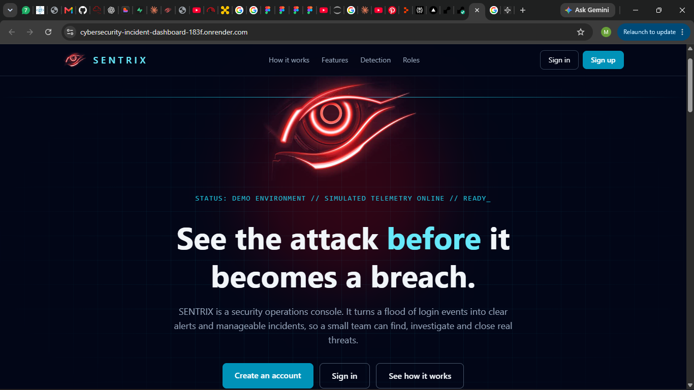
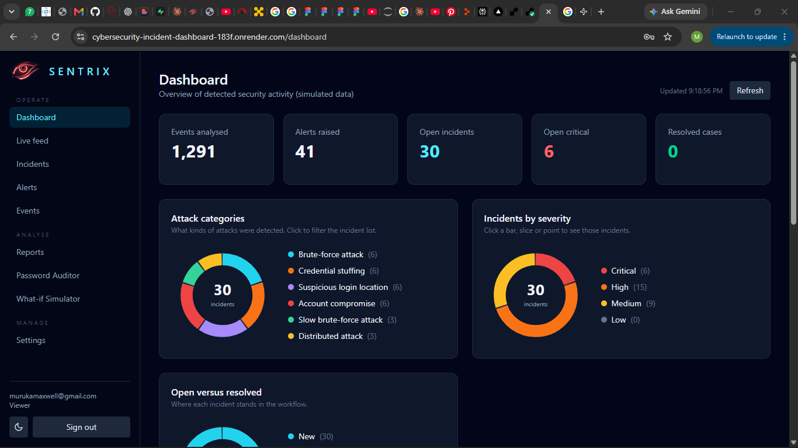
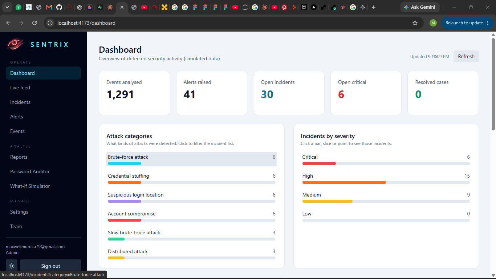
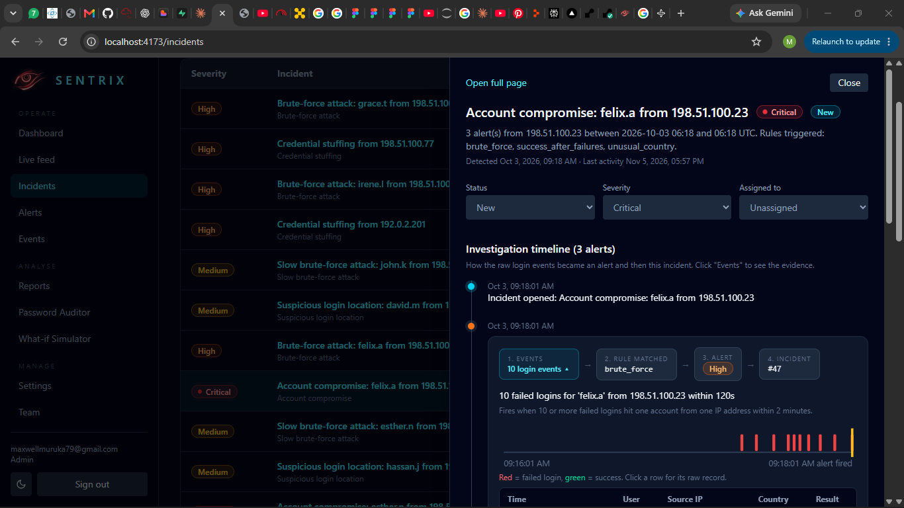
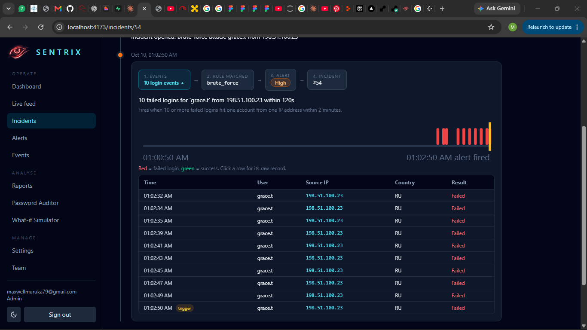
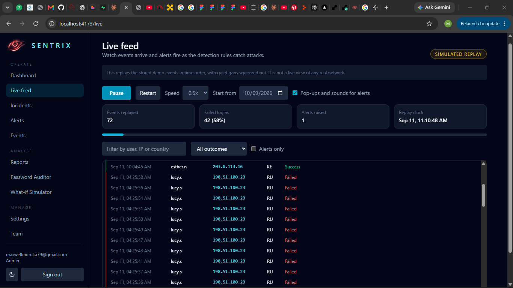
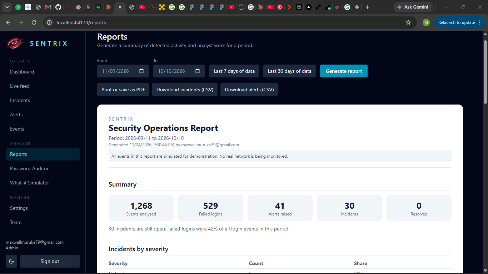
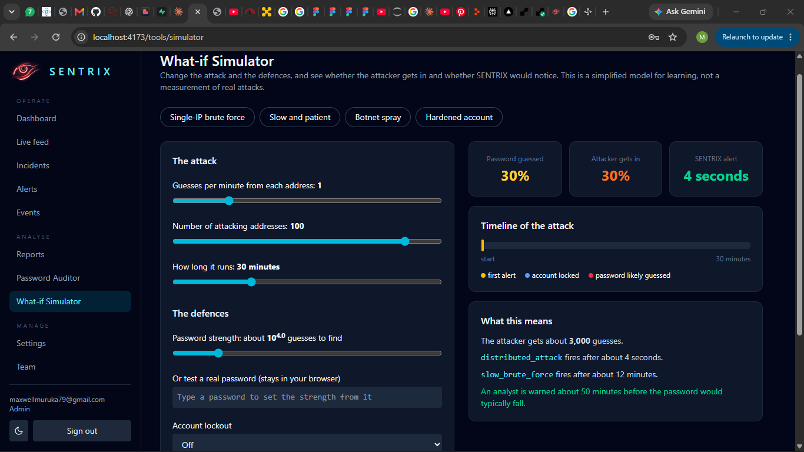
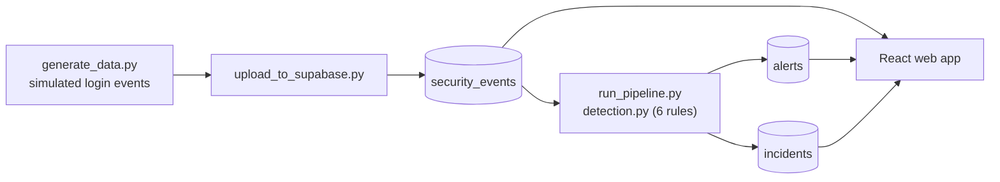

# SENTRIX

**A security operations console that turns raw login events into alerts, and alerts into incidents an analyst can investigate and close.**


SENTRIX ingests authentication events, runs rule-based detection over them, groups related alerts into incidents, and gives
a small security team a console to triage, assign, investigate and report on those incidents. It was built as a university
project (DICT 240, Daystar University).

> **Demo data is simulated.** The project ships with a generator that produces realistic login traffic with hidden attacks
> planted in it. SENTRIX does not monitor any real network. See [Limitations](#limitations) and the [roadmap](#roadmap-towards-real-monitoring).

## Screenshots

| | |
|---|---|
|  **Landing page** |  **Dashboard (dark)** |
|  **Dashboard (light)** |  **Incident side panel** |
|  **Event to incident timeline** |  **Live feed (simulated replay)** |
|  **Reports** |  **What-if simulator** |

## Features

**Detection and investigation**
- Six detection rules covering brute force, slow brute force, credential stuffing, distributed attacks, account takeover and logins from unusual countries
- Alerts grouped into incidents, with a **side panel** to change status or severity, assign an owner and keep a note trail
- **Event to incident timeline**: for every alert, the raw events that triggered it, the rule that matched, and the incident it joined, with a time-axis strip and the raw stored record behind each event
- **Live feed**: replays the stored events in time order and raises alert cards as the rules fire, with pause, speed and filters

**Analytics and reporting**
- Animated dashboard with clickable metrics and charts. One setting restyles every chart as bars, line, donut or radar
- Click a day on the incidents-per-day chart to see that day's incidents
- Reports for any date range: print or save as PDF, export incidents and alerts to CSV
- Events page with server-side filters and paging (it handles datasets larger than a browser could load at once), and an alerts page with search and filters

**Tools**
- **Password Auditor**: strength meter, an explanation of why a password is weak, and crack-time estimates. Runs entirely in the browser
- **What-if Simulator**: change an attack and the defences (lockout, MFA, password strength) and see whether SENTRIX would notice, using the live detection thresholds

**Access and security**
- Sign up and sign in, with role-based access (admin, analyst, viewer) enforced in the database
- Optional two-factor authentication (authenticator app), enforced by the database for enrolled accounts
- Admin Team page to manage roles

**Experience**
- Dark and light themes, density and colour-blind-friendly palettes, notification routing (in-app, sound, desktop)
- Animated eye preloader and landing page, with reduced-motion support

## How it works



1. **Events** are login attempts: who, from which IP and country, and whether it worked.
2. **Detection rules** (`detection.py`) scan them for attack patterns.
3. A matching rule raises an **alert** with a severity and the evidence behind it.
4. **Alerts are grouped into incidents** by source IP (a new incident starts after a 30 minute quiet gap). Attacks that come from many IPs have no single source, so they are grouped by the account being attacked.

### Detection rules

| Rule | What it catches | Threshold | Severity |
|---|---|---|---|
| `brute_force` | Many failed logins on one account from one IP | 10+ failures within 2 minutes | High |
| `slow_brute_force` | The same, spread out to avoid the fast rule | 12+ failures within 30 minutes | Medium |
| `credential_stuffing` | One IP failing against many usernames | 6+ usernames within 5 minutes | High |
| `distributed_attack` | One account hit from many IPs | 6+ different IPs within 5 minutes | High |
| `success_after_failures` | A login succeeds right after a burst of failures | 5+ failures within 60 seconds | Critical |
| `unusual_country` | A login from a country the user never signs in from | Usual country per user | Medium |

Thresholds live in the `detection_rules` table and are shown in the interface.

## Detection results

The generator plants known attacks and harmless look-alikes ("bait") in the traffic, and records the answers in
`ground_truth.json`. `score_detection.py` then checks how the rules did. Results on the default dataset
(1,291 events over 30 days, 41 alerts, 30 incidents):

| Scenario | Detected |
|---|---|
| Brute force | 6 / 6 |
| Credential stuffing | 6 / 6 |
| Account compromise | 6 / 6 |
| Unusual country login | 6 / 6 |
| Low and slow brute force (stealth) | 3 / 3 |
| Distributed spray (stealth) | 3 / 3 |
| **All attacks** | **30 / 30** |
| False alarms on 8 harmless look-alikes (a forgetful user, a shared office IP) | **0** |

With only the first four rules, the two stealth attack types slipped through (24 / 30). The `slow_brute_force` and
`distributed_attack` rules were added to close those gaps.

**How much to trust these numbers:** the attacks and the rules were developed together, so a perfect score shows the rules
are consistent with their own test scenarios, not that they would perform the same on real traffic. Known ways to evade
them: guessing slower than about one password every 2.5 minutes, or spreading an attack across fewer than 6 IPs.

## Tech stack

| Layer | Technology |
|---|---|
| Frontend | React, TypeScript, Vite, Tailwind CSS, React Router |
| Backend and database | Supabase (PostgreSQL, Auth, Row Level Security, Realtime) |
| Detection and data | Python 3 |

## Getting started

### Prerequisites
- Python 3.10+, Node.js 20+, a free [Supabase](https://supabase.com) project

### 1. Set up the database
1. In your Supabase project, open the **SQL Editor** and run `supabase/schema.sql`.
2. Open **Authentication, Providers, Email**. For a demo, consider turning **Confirm email** off (the built-in email sender has strict limits).
3. Optional: turn on live updates with `alter publication supabase_realtime add table incidents, alerts;`
4. Optional: run `supabase/migration_03_mfa.sql` to make the database enforce two-factor sign-in for accounts that enable it.

### 2. Load the demo data (Python)
```bash
pip install -r requirements.txt
cp .env.example .env            # then fill in SUPABASE_URL and SUPABASE_SERVICE_ROLE_KEY
python generate_data.py         # creates events.csv and ground_truth.json
python upload_to_supabase.py --wipe
python run_pipeline.py --reset  # detection, then alerts and incidents
python score_detection.py       # optional: score the rules against the planted attacks
```
`python run_pipeline.py --dry-run` runs the whole pipeline locally from `events.csv` and writes nothing, so it needs no keys.
`generate_data.py` accepts `--days`, `--attacks`, `--stealth`, `--bait` and `--seed`.

### 3. Run the web app
```bash
cd web
npm install
cp .env.local.example .env.local   # fill in VITE_SUPABASE_URL and VITE_SUPABASE_PUBLISHABLE_KEY
npm run dev
```
Open the address it prints (usually http://localhost:5173).

### 4. Create your admin account
Sign up in the app, then make yourself an admin by running this in the SQL Editor (new accounts start as read-only viewers):
```sql
update profiles set role = 'admin' where email = 'you@example.com';
```

### Environment variables

| File | Variable | Used by | Notes |
|---|---|---|---|
| `.env` | `SUPABASE_URL` | Python scripts | Project URL |
| `.env` | `SUPABASE_SERVICE_ROLE_KEY` | Python scripts | **Secret key. Bypasses security rules. Never put it in the web app.** |
| `web/.env.local` | `VITE_SUPABASE_URL` | Web app | Project URL |
| `web/.env.local` | `VITE_SUPABASE_PUBLISHABLE_KEY` | Web app | Safe for browsers. Access is controlled by Row Level Security |

Both files are git-ignored.

## Project structure

```
.
├── generate_data.py        simulated events, planted attacks, benign look-alikes
├── detection.py            the six detection rules
├── run_pipeline.py         events -> alerts -> incidents
├── score_detection.py      scores the rules against ground_truth.json
├── upload_to_supabase.py   loads events.csv into Supabase
├── supabase/               schema and migrations (roles, two-factor enforcement)
└── web/                    the React app
    └── src/
        ├── pages/          dashboard, incidents, alerts, events, live feed, reports, settings, tools, team
        ├── components/     incident panel, investigation timeline, charts, preloader
        └── lib/            auth and MFA, settings and themes, password and attack models, notifications
```

## Security

- **Row Level Security on every table.** Roles (admin, analyst, viewer) are enforced by the database, so a user cannot do through the API what the interface would not let them do.
- **Least privilege by default:** new sign-ups are read-only viewers until an admin promotes them.
- **Two-factor authentication** (TOTP). For enrolled accounts the database refuses data unless the session has passed the second factor.
- **Secrets:** the privileged key stays in a local, git-ignored `.env` and is only used by the Python scripts. The browser only ever holds the publishable key.
- **Audit trail:** every status, severity and assignment change is recorded on the incident.
- **CSV exports** neutralise spreadsheet formulas, since analyst notes are free text.
- **Password Auditor** analyses everything locally. Nothing typed is transmitted or stored.

## Limitations

- All data is **simulated**. SENTRIX does not connect to or monitor any real network.
- The **timeline evidence is reconstructed** from each rule's time window, because alerts do not yet store the IDs of the events that caused them. For this dataset the rebuild matches the rules in all 41 cases.
- The **Password Auditor and What-if Simulator are models** built on stated assumptions, intended for comparison and learning, not prediction.
- Email and Slack alert delivery are not implemented (they need a server-side service). They appear disabled in Settings.
- Interface settings are saved per browser, not per account.

## Roadmap towards real monitoring

The detection rules, database and incident workflow are already the right shape. What changes is the front of the pipeline:

1. **Real log ingestion:** a small agent or API endpoint to ship logs into `security_events`, with a key per source
2. **A honeypot** (for example a decoy SSH server on a cheap VPS) as a safe source of genuine attack traffic
3. **A continuously running detection worker** instead of a command run by hand
4. **Enrichment:** real IP geolocation and reputation lookups
5. **Alert delivery** by email, Slack and webhook from a server
6. **Hardening and operations:** event-to-alert links, data retention, rate limits, tests and CI

SENTRIX should only ever be pointed at systems and logs you own or are authorised to monitor.

## Author

Built by [@maxwellmuruka79](https://github.com/maxwellmuruka79).